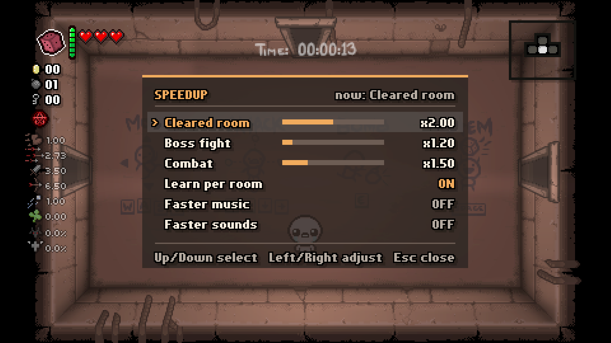
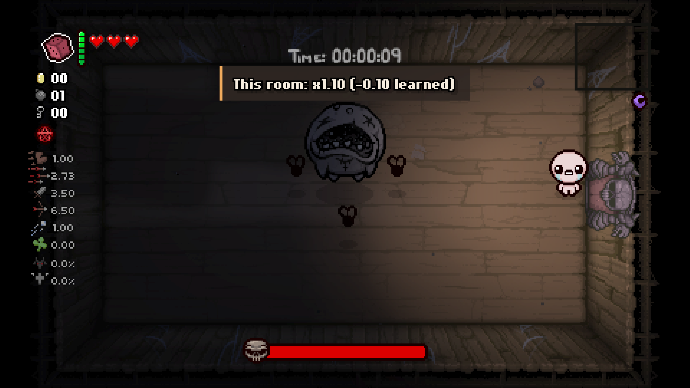

# Speedup - Game Speed Control

A pure Lua mod for The Binding of Isaac: Repentance(+) that makes the whole game run faster. You, enemies, tears and timers all speed up together, so runs play the same, just shorter.

It works by running extra `Game():Update()` ticks each frame, so no external tools or DLLs are needed.

## Install

Copy the `speedup` folder into the game's `mods` folder (or subscribe on the Steam Workshop).

## Use

- `\` opens the panel: Up/Down select, Left/Right adjust (hold to repeat), Esc to close.
- `[` / `]` adjust the speed of the current situation.
- Separate speeds for cleared rooms, boss fights and combat; optional faster music / sound effects.
- Optional Learn per room: each room layout remembers its own speed across runs (+0.05 for a no-hit clear, -0.10 when hit).
- Also shows up in Mod Config Menu Pure if it is installed.
